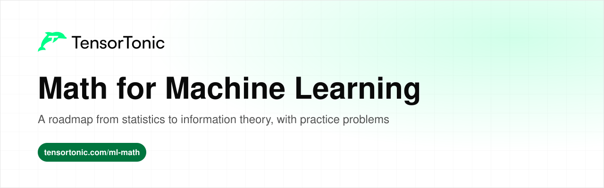
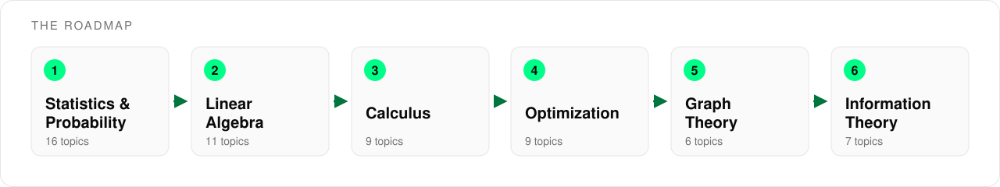

# Math for Machine Learning

  

This is a roadmap of the math behind machine learning, in the order you are likely to need it. It covers 58 topics across six stages, from statistics and probability to information theory.

Every topic links to a short explanation and to practice problems where you implement the idea in Python and check your code against tests. Reading about the chain rule and writing a backward pass that passes are two very different levels of understanding, and the problems are there to get you to the second one.

## Table of Contents

- [Who this is for](#who-this-is-for)
- [How to use this roadmap](#how-to-use-this-roadmap)
- [Stage 1: Statistics and Probability](#stage-1-statistics-and-probability)
- [Stage 2: Linear Algebra](#stage-2-linear-algebra)
- [Stage 3: Calculus](#stage-3-calculus)
- [Stage 4: Optimization](#stage-4-optimization)
- [Stage 5: Graph Theory](#stage-5-graph-theory)
- [Stage 6: Information Theory](#stage-6-information-theory)
- [What's next](#whats-next)

## Who this is for

This roadmap is for anyone who wants to understand why ML models work instead of only calling library functions.

- If you are a **student**, go through the stages in order and do at least one problem per topic.
- If you are **preparing for interviews**, the statistics, linear algebra and optimization stages cover most of the math questions that come up.
- If you already **work in ML**, use the tables as a checklist and jump straight to the topics you have never implemented yourself.

You need basic Python and some high school algebra. You do not need a math degree, and you do not need to finish every stage before you start building models.

## How to use this roadmap

Each stage builds on the ones before it. Calculus is written in the language of vectors and matrices, optimization needs gradients, and the later stages reuse all of it.

For each topic, read the explanation first, then solve one or two of the practice problems. If a problem feels too hard, the explanation page usually shows the exact formula you need. Topics without a practice link are worth reading because later topics depend on them.

## Stage 1: Statistics and Probability

Models make predictions under uncertainty, and you need statistics to tell whether a result is real or noise. This stage starts with describing data, moves through probability and distributions, and ends with the tools used to test models and estimate their parameters.

| Topic | Read | Practice |
| --- | --- | --- |
| Descriptive statistics | [What are descriptive statistics?](https://www.tensortonic.com/ml-math/statistics/basic-statistics) | [Mean, Median and Mode](https://www.tensortonic.com/problems/mean-median-mode), [Sample Variance & Standard Deviation](https://www.tensortonic.com/problems/probstat-sample-var-std) |
| Random variables | [What is a random variable?](https://www.tensortonic.com/ml-math/probability/random-variables) | [Discrete Moments](https://www.tensortonic.com/problems/probstat-discrete-moments) |
| Conditional probability | [What is conditional probability?](https://www.tensortonic.com/ml-math/probability/conditional-probability) | [Conditional Probability](https://www.tensortonic.com/problems/probstat-conditional-probability) |
| Bayes' theorem | [What is Bayes' theorem?](https://www.tensortonic.com/ml-math/probability/bayes-theorem) | [Bayes' Theorem](https://www.tensortonic.com/problems/probstat-bayes-theorem) |
| Distributions | [PMF vs PDF vs CDF](https://www.tensortonic.com/ml-math/probability/distributions) | [Normal Distribution](https://www.tensortonic.com/problems/probstat-normal-distribution) |
| Joint and marginal probability | [Joint vs marginal vs conditional](https://www.tensortonic.com/ml-math/probability/joint-marginal) | [Independence Testing](https://www.tensortonic.com/problems/probstat-independence-testing) |
| Covariance matrix | [What is a covariance matrix?](https://www.tensortonic.com/ml-math/probability/covariance-matrix) | [Compute Covariance Matrix](https://www.tensortonic.com/problems/covariance-matrix) |
| Correlation | [Correlation](https://www.tensortonic.com/ml-math/statistics/correlation) | [Compute Pearson Correlation Matrix](https://www.tensortonic.com/problems/pearson-correlation), [Correlation Significance Test](https://www.tensortonic.com/problems/probstat-correlation-significance) |
| Sampling distributions | [What is a sampling distribution?](https://www.tensortonic.com/ml-math/statistics/sampling-distribution) | [Sampling Distribution of the Mean](https://www.tensortonic.com/problems/probstat-sampling-distribution) |
| Central limit theorem | [What is the CLT?](https://www.tensortonic.com/ml-math/statistics/central-limit-theorem) | [Central Limit Theorem](https://www.tensortonic.com/problems/probstat-clt-confidence-interval) |
| Confidence intervals | [What is a confidence interval?](https://www.tensortonic.com/ml-math/statistics/confidence-interval) | [Bootstrap Confidence Interval](https://www.tensortonic.com/problems/probstat-bootstrap-ci) |
| Hypothesis testing and p-values | [What is hypothesis testing?](https://www.tensortonic.com/ml-math/statistics/hypothesis-testing), [What is a p-value?](https://www.tensortonic.com/ml-math/statistics/p-value) | [Z-Test (One Sample)](https://www.tensortonic.com/problems/probstat-z-test-one-sample), [T-Test (One Sample)](https://www.tensortonic.com/problems/probstat-t-test-one-sample) |
| A/B testing | [A/B testing](https://www.tensortonic.com/ml-math/statistics/ab-testing) | [A/B Test Significance](https://www.tensortonic.com/problems/probstat-ab-test-significance) |
| Maximum likelihood estimation | [What is MLE?](https://www.tensortonic.com/ml-math/statistics/maximum-likelihood-estimation) | [Maximum Likelihood Estimation](https://www.tensortonic.com/problems/probstat-mle-normal) |
| Bayesian vs frequentist | [Bayesian vs frequentist](https://www.tensortonic.com/ml-math/statistics/bayesian-frequentist) | [Bayesian Updating](https://www.tensortonic.com/problems/probstat-bayesian-updating) |
| Monte Carlo methods | [What are Monte Carlo methods?](https://www.tensortonic.com/ml-math/probability/monte-carlo) | [Monte Carlo Pi Estimation](https://www.tensortonic.com/problems/probstat-monte-carlo-pi) |

## Stage 2: Linear Algebra

Data, model weights and activations are all vectors and matrices, so almost every line of ML code is linear algebra. Focus on what each operation does geometrically. You will rarely compute a decomposition by hand, but you will need to know which one to reach for.

| Topic | Read | Practice |
| --- | --- | --- |
| Dot product and norms | [What is the dot product?](https://www.tensortonic.com/ml-math/linear-algebra/dot-norm) | [Dot Product](https://www.tensortonic.com/problems/dot-product), [Cosine Similarity](https://www.tensortonic.com/problems/cosine-similarity) |
| Matrix multiplication | [How matmul works](https://www.tensortonic.com/ml-math/linear-algebra/matrix-multiplication) | [Matrix Multiply](https://www.tensortonic.com/problems/la-matrix-multiply), [Matrix-Vector Multiply](https://www.tensortonic.com/problems/la-matrix-vector-multiply) |
| Determinants and inverses | [What the determinant tells you](https://www.tensortonic.com/ml-math/linear-algebra/determinants-inverses) | [Matrix Determinant](https://www.tensortonic.com/problems/la-matrix-determinant), [Solve Linear System](https://www.tensortonic.com/problems/la-solve-linear-system) |
| Orthogonality | [What does orthogonal mean?](https://www.tensortonic.com/ml-math/linear-algebra/orthogonality) | [Vector Projection](https://www.tensortonic.com/problems/la-vector-projection), [Gram-Schmidt Orthogonalization](https://www.tensortonic.com/problems/la-gram-schmidt) |
| Projections and least squares | [What is least squares?](https://www.tensortonic.com/ml-math/linear-algebra/projections-least-squares) | [Least Squares Solution](https://www.tensortonic.com/problems/la-least-squares) |
| LU and QR decomposition | [What are LU and QR?](https://www.tensortonic.com/ml-math/linear-algebra/lu-qr-decomposition) | [LU Decomposition](https://www.tensortonic.com/problems/la-lu-decomposition), [QR Decomposition](https://www.tensortonic.com/problems/la-qr-decomposition) |
| Eigenvalues and eigenvectors | [What are eigenvalues?](https://www.tensortonic.com/ml-math/linear-algebra/eigenvalue-eigenvector) | [Calculate Eigenvalues of a Matrix](https://www.tensortonic.com/problems/eigenvalues), [Eigendecomposition](https://www.tensortonic.com/problems/la-eigendecomposition) |
| Positive definite matrices | [What is positive definite?](https://www.tensortonic.com/ml-math/linear-algebra/positive-definite) | [Cholesky Decomposition](https://www.tensortonic.com/problems/la-cholesky) |
| SVD | [What is SVD?](https://www.tensortonic.com/ml-math/linear-algebra/svd) | [SVD Components](https://www.tensortonic.com/problems/la-svd-components), [Low-Rank Approximation](https://www.tensortonic.com/problems/la-low-rank-approx) |
| PCA | [What is PCA?](https://www.tensortonic.com/ml-math/linear-algebra/pca) | [PCA from Scratch](https://www.tensortonic.com/problems/ml-pca) |
| Matrix calculus | [What is matrix calculus?](https://www.tensortonic.com/ml-math/linear-algebra/matrix-calculus) | [Gradient of a Matrix-Valued Function](https://www.tensortonic.com/problems/calculus-matrix-function-gradient), [JVP and VJP for a 2-Layer Network](https://www.tensortonic.com/problems/calculus-jvp-vjp) |

## Stage 3: Calculus

Training a model means changing its weights to lower a loss, and derivatives tell you which way to change them. The chain rule is the one idea to understand deeply, because backpropagation is the chain rule applied to a whole network.

| Topic | Read | Practice |
| --- | --- | --- |
| Limits and continuity | [What is a limit?](https://www.tensortonic.com/ml-math/calculus/limits-continuity) | [Continuity of Activation Functions](https://www.tensortonic.com/problems/calculus-activation-continuity) |
| Partial derivatives and gradients | [What is a partial derivative?](https://www.tensortonic.com/ml-math/calculus/partial-derivatives) | [Gradient of Multivariate Linear Regression Loss](https://www.tensortonic.com/problems/calculus-linreg-gradient), [Finite Difference Gradient Checking](https://www.tensortonic.com/problems/calculus-gradient-check) |
| Chain rule | [What is the chain rule?](https://www.tensortonic.com/ml-math/calculus/chain-rule) | [Chain Rule Through a 3-Layer Network](https://www.tensortonic.com/problems/calculus-chain-rule-3layer) |
| Vector fields and directional derivatives | [Vector fields](https://www.tensortonic.com/ml-math/calculus/vector-fields) | [Directional Derivative & Steepest Descent Direction](https://www.tensortonic.com/problems/calculus-directional-derivative) |
| Jacobian and Hessian | [Jacobian vs Hessian](https://www.tensortonic.com/ml-math/calculus/jacobian-hessian) | [Jacobian of a Vector-Valued Polynomial](https://www.tensortonic.com/problems/calculus-jacobian-computation), [Hessian Matrix & Convexity of Linear Regression Loss](https://www.tensortonic.com/problems/calculus-hessian-convexity) |
| Taylor series | [What is a Taylor series?](https://www.tensortonic.com/ml-math/calculus/taylor-series) | [Taylor Approximation of a Loss Landscape](https://www.tensortonic.com/problems/calculus-taylor-approximation) |
| Minima and saddle points | [Minimum vs saddle](https://www.tensortonic.com/ml-math/calculus/local-vs-saddle) | [Classify a Critical Point from the Hessian](https://www.tensortonic.com/problems/optim-critical-point-classification) |
| Integration and AUC | [How AUC is calculated](https://www.tensortonic.com/ml-math/calculus/integration-auc) | [Area Under the ROC Curve via Trapezoidal Rule](https://www.tensortonic.com/problems/calculus-roc-auc) |
| Backpropagation | [How backpropagation works](https://www.tensortonic.com/ml-math/calculus/backpropagation) | [Run Reverse-Mode Autodiff](https://www.tensortonic.com/problems/autograd-l05-reverse-mode-autodiff) |

## Stage 4: Optimization

Optimization is where the earlier stages come together. Gradients from calculus, matrices from linear algebra and losses from statistics combine into the update rules that train every model, and most of the practical tricks of training live here.

| Topic | Read | Practice |
| --- | --- | --- |
| Gradient descent and convexity | [Convex optimization](https://www.tensortonic.com/ml-math/optimization/convex-optimization) | [Vanilla Gradient Descent](https://www.tensortonic.com/problems/optim-vanilla-gd) |
| Loss landscapes | [What is a loss landscape?](https://www.tensortonic.com/ml-math/optimization/loss-landscapes) | [Gradient Descent on a Non-Convex Loss](https://www.tensortonic.com/problems/calculus-gd-nonconvex) |
| Batch, mini-batch and SGD | [Batch vs mini-batch vs SGD](https://www.tensortonic.com/ml-math/optimization/sgd-variants) | [Batch vs Stochastic vs Mini-Batch GD](https://www.tensortonic.com/problems/optim-batch-vs-sgd) |
| Momentum | [Momentum vs Nesterov](https://www.tensortonic.com/ml-math/optimization/momentum-nesterov) | [Classical Momentum](https://www.tensortonic.com/problems/optim-classical-momentum), [Nesterov Momentum](https://www.tensortonic.com/problems/optim-nesterov) |
| Adaptive learning rates | [Adam vs RMSprop vs AdaGrad](https://www.tensortonic.com/ml-math/optimization/adaptive-rates) | [RMSProp](https://www.tensortonic.com/problems/optim-rmsprop), [Adam Optimizer](https://www.tensortonic.com/problems/optim-adam) |
| Newton's method | [How Newton's method works](https://www.tensortonic.com/ml-math/optimization/newtons-method) | [Newton's Method](https://www.tensortonic.com/problems/optim-newtons-method) |
| Regularization | [L1 vs L2](https://www.tensortonic.com/ml-math/optimization/regularization) | [Ridge Regression: Closed-Form Solution](https://www.tensortonic.com/problems/ridge-regression) |
| Lagrange multipliers | [What are Lagrange multipliers?](https://www.tensortonic.com/ml-math/optimization/lagrange-multipliers) | [Regularization as Constrained Optimization](https://www.tensortonic.com/problems/calculus-lagrange-regularization) |
| Batch normalization | [What is batch norm?](https://www.tensortonic.com/ml-math/optimization/batch-normalization) | [Batch Normalization](https://www.tensortonic.com/problems/dl-batch-normalization) |

## Stage 5: Graph Theory

Graphs describe how things connect, from users and items in a recommender to atoms in a molecule. They also describe computation itself, since every autograd library records a model as a graph and walks it backwards to compute gradients.

| Topic | Read | Practice |
| --- | --- | --- |
| Graph representations | [Matrix vs list](https://www.tensortonic.com/ml-math/graph-theory/graph-representations) | [Matrix-Vector Multiply](https://www.tensortonic.com/problems/la-matrix-vector-multiply) |
| Computational graphs | [What is a computational graph?](https://www.tensortonic.com/ml-math/graph-theory/computational-graphs) | [Build a Scalar Expression Graph](https://www.tensortonic.com/problems/autograd-l02-build-expression-graph), [Topologically Sort a Computation DAG](https://www.tensortonic.com/problems/autograd-l05-topological-sort) |
| Random walks | [What is a random walk?](https://www.tensortonic.com/ml-math/graph-theory/random-walks) | [Calculate Eigenvalues of a Matrix](https://www.tensortonic.com/problems/eigenvalues) |
| Spectral graph theory | [What is spectral graph theory?](https://www.tensortonic.com/ml-math/graph-theory/spectral-graph) | [Eigendecomposition](https://www.tensortonic.com/problems/la-eigendecomposition), [K-Means Clustering](https://www.tensortonic.com/problems/ml-kmeans) |
| Message passing | [What is message passing in GNNs?](https://www.tensortonic.com/ml-math/graph-theory/message-passing) | |
| Graph neural networks | [What is a GNN?](https://www.tensortonic.com/ml-math/graph-theory/gnn-intro) | |

## Stage 6: Information Theory

Information theory explains the losses used to train classifiers and language models. Cross-entropy, KL divergence and perplexity all come from the same idea of measuring how surprised a model is by the data.

| Topic | Read | Practice |
| --- | --- | --- |
| Entropy | [What is Shannon entropy?](https://www.tensortonic.com/ml-math/information-theory/shannon-entropy) | [Compute Entropy for a Node](https://www.tensortonic.com/problems/entropy-node) |
| Cross-entropy | [What is cross-entropy?](https://www.tensortonic.com/ml-math/information-theory/cross-entropy) | [Cross-Entropy Loss](https://www.tensortonic.com/problems/cross-entropy-loss) |
| KL divergence | [What is KL divergence?](https://www.tensortonic.com/ml-math/information-theory/kl-divergence) | [KL Divergence](https://www.tensortonic.com/problems/kl-divergence), [KL Divergence: Discrete and Continuous](https://www.tensortonic.com/problems/calculus-kl-divergence) |
| Jensen-Shannon divergence | [Jensen-Shannon divergence](https://www.tensortonic.com/ml-math/information-theory/jensen-shannon) | |
| Mutual information | [What is mutual information?](https://www.tensortonic.com/ml-math/information-theory/mutual-information) | |
| Information gain | [What is information gain?](https://www.tensortonic.com/ml-math/information-theory/information-gain) | [Compute Information Gain for a Split](https://www.tensortonic.com/problems/information-gain), [Decision Tree Best Split](https://www.tensortonic.com/problems/decision-tree-split) |
| Perplexity | [What is perplexity?](https://www.tensortonic.com/ml-math/information-theory/perplexity) | [Perplexity Computation](https://www.tensortonic.com/problems/perplexity-computation) |

## What's next

Once the math feels familiar, the next step is to use it to build models. The [problem list](https://www.tensortonic.com/problems) has problems that go from a single loss function up to full training loops, and the [ML Math](https://www.tensortonic.com/ml-math) page has visual explanations of every topic above.

For a written overview of how much math you need and in what order, read the [What Maths Do You Need for Machine Learning?](https://www.tensortonic.com/guides/maths-for-machine-learning) guide. The [ML Math Formula Sheet](https://www.tensortonic.com/guides/ml-math-formula-sheet) collects the statistics, linear algebra and calculus formulas from these stages on one page, and the [linear algebra guide](https://www.tensortonic.com/guides/learn-linear-algebra-for-machine-learning) shows how to learn Stage 2 through code if your math is shaky.

Stage 1 is also the subject of the [Statistics Interview Questions](https://www.tensortonic.com/guides/statistics-interview-questions) guide, which covers the probability and statistics questions asked in machine learning and data science interviews.

## License

MIT
